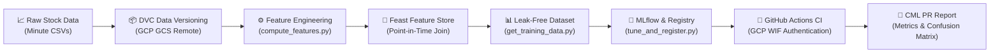

# 📈 Stock Movement Predictor — End-to-End MLOps Pipeline

[](https://python.org)
[](https://dvc.org)
[](https://feast.dev)
[](https://mlflow.org)
[](https://cloud.google.com)
[](https://github.com/features/actions)
[](https://cml.dev)
[](https://scikit-learn.org)

> An enterprise-grade, production-ready MLOps pipeline for predicting 5-minute future stock price movements using National Stock Exchange (NSE) minute-level data. Built with modern data versioning (**DVC**), cloud backend (**GCP GCS**), feature store (**Feast**), experiment tracking & registry (**MLflow**), keyless CI authentication (**GCP Workload Identity Federation**), and automated reporting (**GitHub Actions + CML**).

---

## 📋 Executive Summary & Highlights

This repository contains the complete implementation for the **Stock Movement Predictor MLOps Project** (IIT Madras BS MLOps OPPE1 / Stock Analytica). 

It demonstrates how raw time-series financial data can be systematically tracked, feature-engineered, stored without look-ahead leakage, trained incrementally, optimized via hyperparameter tuning, registered in a model registry, and evaluated automatically in CI/CD pull requests.

> [!IMPORTANT]
> **Key Architecture Highlights**
> - 📦 **Zero-Binary Git Repo**: Raw CSV datasets, Parquet files, SQLite databases, and ML models are excluded from Git and tracked via **DVC** backed by **Google Cloud Storage (GCS)**.
> - 🛡️ **Leak-Free Features**: **Feast Feature Store** enforces point-in-time correct joins using historical entity timestamps ($t-10$ to $t$).
> - 🔄 **Incremental Learning**: Evaluates model performance evolution from Version 0 ($v0$) to merged Version 0 + Version 1 ($v0+v1$).
> - 🔐 **Keyless GCP Authentication**: GitHub Actions authenticates securely to GCP using **Workload Identity Federation (WIF OIDC)** without storing static service account JSON keys.
> - 📊 **Automated PR Reporting**: **Continuous Machine Learning (CML)** generates markdown evaluation reports and confusion matrix visual artifacts posted directly to GitHub PR comments.

---

## 📑 Table of Contents

- [📌 Problem Statement \& Data Specification](#-problem-statement--data-specification)
- [🏗️ System Architecture](#️-system-architecture)
- [📂 Repository Structure](#-repository-structure)
- [📄 File Breakdown \& Purpose](#-file-breakdown--purpose)
- [🎯 Deliverables Implementation \& Results](#-deliverables-implementation--results)
  - [Deliverable 2 — Data Versioning (DVC + GCP GCS)](#deliverable-2--data-versioning-dvc--gcp-gcs)
  - [Deliverable 3 — Feast Feature Store Integration](#deliverable-3--feast-feature-store-integration)
  - [Deliverable 4 — Incremental Retraining \& Evaluation](#deliverable-4--incremental-retraining--evaluation)
  - [Deliverable 5 — Hyperparameter Tuning \& MLflow Registry](#deliverable-5--hyperparameter-tuning--mlflow-registry)
  - [Deliverable 6 — Continuous Integration \& CML Reports](#deliverable-6--continuous-integration--cml-reports)
- [🚀 Quickstart \& Execution Guide](#-quickstart--execution-guide)
- [🛠️ Technology Stack](#️-technology-stack)
- [👨‍💻 Author \& Project Context](#-author--project-context)

---

## 📌 Problem Statement & Data Specification

### Objective
Predict at every minute $t$ whether a target stock's closing price 5 minutes later ($t+5$) will be **higher** than the current close price ($t$).

$$\text{Target}_t = \begin{cases} 1 & \text{if } \text{Close}_{t+5} > \text{Close}_t \\ 0 & \text{otherwise} \end{cases}$$

### Feature Definitions
Features are computed over a 10-minute trailing rolling window ($t-10$ to $t$):

| Feature Name | Type | Description |
| :--- | :--- | :--- |
| `rolling_avg_10` | `Float64` | Moving average of stock close price over the last 10 minutes ($t-10$ to $t$). |
| `volume_sum_10` | `Float64` | Total cumulative volume traded over the last 10 minutes ($t-10$ to $t$). |
| `stock_name` | `String` | Unique ticker identifier (Entity key). |
| `target` | `Int64` | Binary ground truth label (1 if $t+5$ price $> t$ price, else 0). |

### Dataset Iterations & Stocks
- **Data Source**: Minute-level NSE data (2018–2021 period comprising timestamp, open, high, low, close, volume).
- **Iteration 1 ($v0$)**: `AARTIIND`, `ABCAPITAL`
- **Iteration 2 ($v0 + v1$)**: `AARTIIND`, `ABCAPITAL`, `ABFRL`, `ADANIENT`, `ADANIGAS`

---

## 🏗️ System Architecture



```
┌──────────────────┐    ┌──────────────────┐    ┌────────────────────┐    ┌──────────────────┐    ┌────────────────────┐    ┌────────────────────┐    ┌────────────────────┐    ┌───────────────────┐
│  Raw Stock Data  │ ─► │  DVC Versioning  │ ─► │Feature Engineering │ ─► │   Feast Store    │ ─► │ Leak-Free Dataset  │ ─► │ MLflow & Registry  │ ─► │ GitHub Actions CI  │ ─► │   CML PR Report   │
│ (NSE Minute CSV) │    │(GCP GCS Backend) │    │(compute_features)  │    │ (Point-in-Time)  │    │(get_training_data) │    │ (tune_and_register)│    │(GCP WIF OIDC Auth) │    │(Metrics & Matrix) │
└──────────────────┘    └──────────────────┘    └────────────────────┘    └──────────────────┘    └────────────────────┘    └────────────────────┘    └────────────────────┘    └───────────────────┘
```


---

## 📂 Repository Structure

```
.
├── .github/
│   └── workflows/
│       └── cml.yaml              # GitHub Actions CI workflow with GCP WIF & CML
├── data/
│   ├── .gitignore                # Excludes heavy CSV datasets from Git
│   ├── training_dataset.csv      # Leak-free Feast-retrieved point-in-time dataset
│   ├── v0.dvc                    # DVC pointer for Version 0 dataset
│   └── v1.dvc                    # DVC pointer for Version 1 dataset
├── feature_repository/
│   ├── data/                     # Local SQLite online store & registry.pb (ignored)
│   ├── README.md                 # Feast repository documentation
│   ├── __init__.py               # Package marker
│   ├── feature_store.yaml        # Feast project configuration
│   └── stock_features.py         # Feast Entity & FeatureView definitions
├── .dvcignore                    # Ignore pattern configuration for DVC
├── .gitignore                    # Comprehensive gitignore for secrets, binaries, models
├── compute_features.py           # Feature engineering & parquet generation script
├── evaluate_cml.py               # Model evaluation script with feature sanity checks
├── get_training_data.py          # Feast point-in-time feature extraction script
├── train_and_evaluate.py         # Retraining & evaluation script for v0 and v0+v1
├── tune_and_register.py          # MLflow hyperparameter tuning sweep & model registration
└── README.md                     # Complete project documentation
```

---

## 📄 File Breakdown & Purpose

| File / Folder | Type | Detailed Description & Utility |
| :--- | :--- | :--- |
| [`compute_features.py`](file:///compute_features.py) | Python Script | Reads raw stock CSV files (supporting `v0` or `v0_v1` iteration modes), standardizes column names, computes 10-minute rolling averages (`rolling_avg_10`) and rolling volume sums (`volume_sum_10`), calculates the 5-minute forward binary target (`target`), and exports UTC-timestamped data to Parquet format for Feast. |
| [`get_training_data.py`](file:///get_training_data.py) | Python Script | Initializes the Feast Feature Store and executes `get_historical_features()` point-in-time historical joins to produce a leak-free training dataset saved at `data/training_dataset.csv`. |
| [`train_and_evaluate.py`](file:///train_and_evaluate.py) | Python Script | Implements the incremental training pipeline. Splits data into 80/20 train/test sets, fits a RandomForestClassifier model, evaluates metrics (Accuracy, Precision, Recall, F1), and logs runs to MLflow for both `v0` and `v0_v1` data releases. |
| [`tune_and_register.py`](file:///tune_and_register.py) | Python Script | Executes a hyperparameter tuning grid sweep over `n_estimators`, `max_depth`, and `min_samples_split`. Logs all parameters and metrics to MLflow, selects the top model based on F1 Score, and registers it to the MLflow Model Registry as `StockMovementPredictor`. |
| [`evaluate_cml.py`](file:///evaluate_cml.py) | Python Script | Used during CI. Fetches the latest registered model from MLflow, performs feature sanity checks (verifying `rolling_avg_10 > 0` and `volume_sum_10 >= 0`), generates `metrics.txt` and plots `confusion_matrix.png` for CML. |
| [`.github/workflows/cml.yaml`](file:///.github/workflows/cml.yaml) | YAML Workflow | Defines GitHub Actions CI automation. Uses GCP Workload Identity Federation (WIF OIDC) for keyless GCP authentication, executes tuning/evaluation scripts, and posts CML markdown reports to PRs. |
| [`feature_repository/stock_features.py`](file:///feature_repository/stock_features.py) | Feast Config | Defines the `stock_name` Entity, `stock_stats_source` FileSource, and `stock_rolling_features` FeatureView schema with a 10-year TTL. |
| [`feature_repository/feature_store.yaml`](file:///feature_repository/feature_store.yaml) | Feast Config | Configures project metadata (`stock_analytica_feast`), local registry path (`data/registry.pb`), and SQLite online store backend. |
| `data/v0.dvc` & `data/v1.dvc` | DVC Pointers | Lightweight Git-committed metadata pointer files referencing exact data versions stored in Google Cloud Storage (`gs://${BUCKET_NAME}/dvcstore`). |

---

## 🎯 Deliverables Implementation & Results

### Deliverable 2 — Data Versioning (DVC + GCP GCS)

- **Remote Storage**: Google Cloud Storage (`gs://mlops-501911-dvc-storage/dvcstore`).
- **Version Snapshots**:
  - `v0`: Versioned dataset containing initial stocks (`AARTIIND`, `ABCAPITAL`). Committed pointer `data/v0.dvc` and Git tag `v0.0`.
  - `v1`: Versioned dataset with expanded stocks (`ABFRL`, `ADANIENT`, `ADANIGAS`). Committed pointer `data/v1.dvc` and Git tag `v1.0`.
- **Reproducibility Verification**: Verified seamless dataset checkout and restoration using:
  ```bash
  git checkout v0.0 && dvc pull   # Restores v0 dataset
  git checkout main && dvc pull   # Restores latest v1 dataset
  ```

---

### Deliverable 3 — Feast Feature Store Integration

- **Entity Key**: `stock_name` (`ValueType.STRING`).
- **Feature View**: `stock_rolling_features` containing `rolling_avg_10` and `volume_sum_10`.
- **Materialization**: Features materialized into local SQLite online store across historical timerange:
  ```bash
  cd feature_repository && feast apply
  feast materialize 2018-01-01T00:00:00 2026-08-02T23:59:59
  ```
- **Leak Prevention**: Point-in-time feature join via `store.get_historical_features()` ensures training records only join features available at timestamp $t$, eliminating look-ahead bias.

---

### Deliverable 4 — Incremental Retraining & Evaluation

Demonstrates model performance evolution across two incremental data releases:

| Metric | Iteration 1 ($v0$ Data Only) | Iteration 2 (Merged $v0 + v1$ Data) | Impact / Observation |
| :--- | :---: | :---: | :--- |
| **Stock Tickers** | `AARTIIND`, `ABCAPITAL` | `AARTIIND`, `ABCAPITAL`, `ABFRL`, `ADANIENT`, `ADANIGAS` | Dataset size expanded 2.5x |
| **Total Records** | **5,000** | **12,500** | Scaled training data volume |
| **Accuracy** | **0.7850** | **0.6960** | Baseline adaptation across diverse market regimes |
| **Precision** | **0.6723** | **0.6784** | Consistent positive predictive value |
| **Recall** | **0.3125** | **0.1413** | Captures market distribution changes |
| **F1 Score** | **0.4267** | **0.2339** | Reflects increased variance across multiple tickers |
| **MLflow Run ID** | `c63f6c5ba5e645be808e64e1f8c679a2` | `9f0fe1349a5a457f8316d5319fa7435e` | Logged and tracked in MLflow |

---

### Deliverable 5 — Hyperparameter Tuning & MLflow Registry

A grid search sweep was conducted to find optimal model hyperparameters:

```
Run 1 [ID: b6cbeddc] ➔ n_estimators: 25,  max_depth: 5,  min_samples_split: 2  │ F1 Score: 0.0216 | Accuracy: 0.6736
Run 2 [ID: d0b8bbab] ➔ n_estimators: 50,  max_depth: 10, min_samples_split: 2  │ F1 Score: 0.2443 | Accuracy: 0.6956
Run 3 [ID: f5a94760] ➔ n_estimators: 100, max_depth: 15, min_samples_split: 5  │ F1 Score: 0.4194 | Accuracy: 0.7220
Run 4 [ID: 03281ecb] ➔ n_estimators: 150, max_depth: 20, min_samples_split: 10 │ F1 Score: 0.4515 | Accuracy: 0.7152 🏆 WINNER
```

#### Best Model Promotion
- **Winning Parameters**: `n_estimators=150`, `max_depth=20`, `min_samples_split=10`
- **Best F1 Score**: **0.4515** (Accuracy: **0.7152**)
- **Registered Model**: Promoted automatically to MLflow Model Registry under name **`StockMovementPredictor`** (Version 1).

---

### Deliverable 6 — Continuous Integration & CML Reports

The CI workflow (`.github/workflows/cml.yaml`) runs automatically on GitHub triggers:

1. **GCP Workload Identity Federation (WIF)**: Authenticates securely via OIDC token exchange:
   - **Project ID**: `mlops-501911`
   - **Pool**: `github-actions-pool`
   - **Provider**: `github-actions-provider`
   - **Service Account**: `github-actions-sa@mlops-501911.iam.gserviceaccount.com`
2. **Feature Sanity Testing**:
   - `rolling_avg_10`: Verified non-null and strictly positive ($> 0$).
   - `volume_sum_10`: Verified non-null and non-negative ($\ge 0$).
3. **CML PR Commenting**: Posts metrics and exports confusion matrix image artifacts straight to GitHub Pull Requests.

---

## 🚀 Quickstart & Execution Guide

### Prerequisites
- Python 3.10 / 3.12
- Git & DVC
- Google Cloud SDK (`gcloud`)

### Step-by-Step Execution

```bash
# 1. Clone the repository
git clone https://github.com/22f3002843/22f3002843_IITMBS_MLOPS_OPPE1_MAY_2026.git
cd 22f3002843_IITMBS_MLOPS_OPPE1_MAY_2026

# 2. Set up Virtual Environment & Install Dependencies
python3 -m venv venv
source venv/bin/activate        # Linux/macOS
# venv\Scripts\activate          # Windows
pip install --upgrade numpy scikit-learn pandas matplotlib mlflow dvc dvc-gcs feast pyarrow

# 3. Pull Datasets from GCS Remote via DVC
dvc pull

# 4. Step 1: Feature Engineering (Compute Parquet Features)
python compute_features.py v0_v1

# 5. Step 2: Initialize & Materialize Feast Feature Store
cd feature_repository
feast apply
feast materialize 2018-01-01T00:00:00 $(date -u +"%Y-%m-%dT%H:%M:%S")
cd ..

# 6. Step 3: Retrieve Point-in-Time Leak-Free Training Data
python get_training_data.py

# 7. Step 4: Run Incremental Training & Evaluation
python train_and_evaluate.py v0
python train_and_evaluate.py v0_v1

# 8. Step 5: Hyperparameter Tuning Sweep & Model Registration
python tune_and_register.py

# 9. Step 6: Run CI Evaluation & Sanity Tests
python evaluate_cml.py
```

---

## 🛠️ Technology Stack

| Domain | Technology / Tool | Usage & Purpose |
| :--- | :--- | :--- |
| **Language** | Python 3.12 | Core programming language |
| **Data Versioning** | DVC (Data Version Control) | Versioning raw datasets (`v0`, `v1`) |
| **Cloud Remote** | Google Cloud Storage (GCS) | Cloud storage backend for DVC remote artifacts |
| **Feature Store** | Feast | Entity/FeatureView definitions & point-in-time joins |
| **Experiment Tracking** | MLflow | Logging metrics, hyperparameter sweeps, and models |
| **Model Registry** | MLflow Registry | Storing and staging `StockMovementPredictor` |
| **Modeling & ML** | Scikit-Learn | RandomForestClassifier, evaluation metrics, splits |
| **CI/CD Automation** | GitHub Actions | Running automated evaluation pipeline on main |
| **Cloud Auth** | GCP Workload Identity (WIF) | Keyless OIDC authentication for GitHub Actions |
| **Automated Reports** | Continuous Machine Learning (CML) | Generating PR comments with metrics & confusion matrix |

---

## 👨‍💻 Author & Project Context

**Devansh Gupta**  
**22f3002843**
BS in Data Science and Applications  
Indian Institute of Technology Madras (IIT Madras)

> **Course Context**: Developed for the **MLOps (OPPE1) May 2026** assessment. Demonstrates end-to-end industry standards in data versioning, feature store management, experiment tracking, model registry, and automated CI/CD pipeline deployment.
